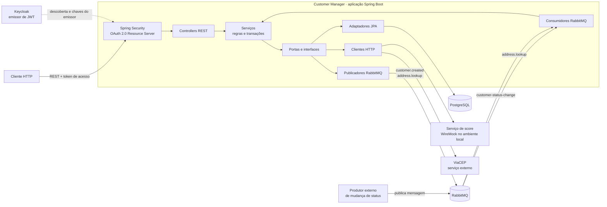
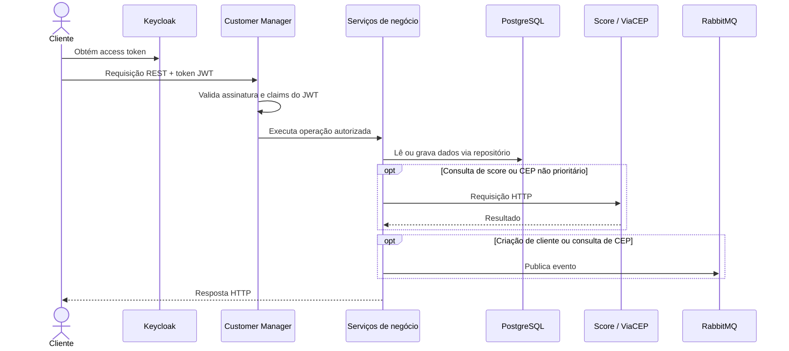

# Arquitetura e decisões técnicas

Este documento descreve a arquitetura observável no código e nas configurações do
projeto. As justificativas abaixo são uma explicação plausível para as escolhas
implementadas, não um registro histórico de ADRs ou de decisões de produto.

## Visão geral

O projeto é uma aplicação Spring Boot única, com API REST e consumidores RabbitMQ
no mesmo processo. A organização segue princípios de arquitetura hexagonal: os
controladores e consumidores recebem chamadas/eventos, os serviços concentram as
operações, e interfaces de repositório, clientes HTTP e publicadores isolam
detalhes de integração. Não são microserviços separados por módulo.



Os componentes PostgreSQL, RabbitMQ, Keycloak e WireMock são disponibilizados
localmente pelo `docker-compose.yml`; a aplicação Java é executada à parte. O
ViaCEP é acessado externamente. No Compose, Keycloak é publicado na porta `8082`
do host e a aplicação usa por padrão o issuer
`http://localhost:8082/realms/customer`. O arquivo `application.yaml` não define
a porta HTTP da aplicação, que portanto segue o padrão do Spring Boot (`8080`).

## Fluxos principais

### API REST e dados



Os endpoints de cliente ficam em `/customers`; os de endereço ficam em
`/addresses`. `CustomerService` e `AddressService` orquestram as operações,
enquanto repositórios e clientes HTTP escondem os detalhes de persistência e
comunicação externa. Entidades e DTOs separam o modelo persistido das
representações da API.

### Consulta de CEP e processamento assíncrono

```mermaid
flowchart LR
    REQ[GET /addresses/{cep}] --> SVC[AddressService]
    SVC -->|normaliza CEP e procura primeiro| DB[(priority_addresses)]
    DB -->|encontrado| RESP[Resposta]
    DB -->|ausente| VIA[ViaCEP]
    VIA --> RESP
    RESP --> PUB[Publica ADDRESS_LOOKUP]
    PUB --> EX[(RabbitMQ<br/>customer.events)]
    EX --> Q[address.lookup.queue]
    Q --> CON[AddressLookupConsumer]
    CON --> LOG[AddressLookupLogService]
    LOG --> HIST[(address_lookup_logs)]
```

O evento leva o CEP, a origem (`INTERNAL` ou `EXTERNAL`) e os dados retornados.
Seu UUID é usado como identificador único do log, e a gravação ocorre em outro
consumidor, sem fazer a resposta REST aguardar o registro. A aplicação também
consome mensagens `customer-status-change`; o serviço tenta registrar o
identificador do evento em `prcssd_mssgs` para evitar duplicidade, mas não altera
o status do cliente.

## Decisões técnicas

| Tecnologia ou escolha | Papel e justificativa plausível |
|---|---|
| Java 26 e Spring Boot 4.1.1 | Plataforma principal da aplicação. O ecossistema Spring integra API REST, segurança, persistência, clientes HTTP e mensageria, reduzindo configuração manual entre esses componentes. |
| Maven | Gerencia dependências, compilação, testes e geração do cliente de score a partir do contrato OpenAPI. As versões e plugins ficam centralizados no `pom.xml`. |
| Arquitetura em camadas com portas e adaptadores | Mantém controllers, serviços, repositórios, clientes externos e mensageria com responsabilidades distintas. Interfaces como `CustomerRepository` e `ScoresApiClient` ajudam a substituir integrações em testes sem tornar o núcleo dependente de um protocolo específico. |
| PostgreSQL | Armazena clientes, endereços prioritários, mensagens processadas e logs de consulta. Constraints, chaves e índices no schema dão suporte a unicidade e consultas estruturadas. |
| Spring Data JPA e Hibernate | Implementam persistência relacional e mapeamento objeto-relacional, evitando SQL repetitivo no fluxo normal. `ddl-auto: validate` verifica o mapeamento contra o schema sem permitir que o Hibernate o altere automaticamente. |
| RabbitMQ e Spring AMQP | Desacoplam a publicação de eventos do processamento de logs de consulta e permitem receber mensagens de mudança de status. Exchanges e filas duráveis, publisher confirms/returns e tentativas limitadas estão configurados. Filas de mudança de status e de consulta de endereço apontam para dead-letter exchange; a fila de criação de cliente não tem essa configuração no código atual. |
| OAuth 2.0 Resource Server, JWT e Keycloak | A API valida access tokens emitidos por um provedor de identidade, em vez de gerenciar credenciais de usuários. O conversor de claims mapeia as roles do realm para authorities do Spring Security; regras de autorização são aplicadas também nos métodos dos controllers. |
| Spring `RestClient` e clientes HTTP | Integram a aplicação ao ViaCEP e ao serviço de score sem acoplar a lógica de negócio ao transporte HTTP. O contrato do score está descrito em OpenAPI e um cliente Java é gerado durante o build; WireMock simula esse serviço no ambiente local. |
| Bean Validation | Valida estruturas de entrada quando aplicado aos DTOs/endpoints, com suporte Jakarta integrado ao Spring. |
| MapStruct e Lombok | MapStruct gera conversões entre modelos em tempo de compilação; Lombok reduz código repetitivo como construtores e logging. A configuração do compilador inclui os processadores de anotações necessários. |
| Springdoc OpenAPI | Publica documentação interativa da API REST; as rotas Swagger e OpenAPI estão liberadas na configuração de segurança. |
| JUnit, Mockito e dependências de teste Spring | Permitem testar unidades e integrações com os componentes Spring sem depender sempre dos serviços reais. |
| Docker Compose | Sobe dependências locais reproduzíveis (PostgreSQL, RabbitMQ, WireMock e Keycloak) e monta scripts SQL e arquivos de mock nos serviços correspondentes. |

Embora o `pom.xml` também declare starters OAuth 2.0 de client e authorization
server, a configuração de segurança atual usa a aplicação como Resource Server:
tokens são emitidos pelo Keycloak, não pela API.

### Transações e persistência

As operações de escrita relevantes são envolvidas por decorators de serviço que
usam `TransactionOperations`/`TransactionTemplate`. Essa opção mantém a definição
da fronteira transacional fora das classes de regra de negócio, preservando o
estilo desacoplado adotado no projeto. Os scripts de schema são mantidos em
`src/main/resources/db/postgresql`; os SQL versionados são carregados pelo
PostgreSQL no bootstrap local do Compose. Não há dependência Flyway ou Liquibase
declarada no `pom.xml`.

### Mensageria e consistência

A configuração usa conversão JSON, confirmações e retornos do publisher, além de
retentativas limitadas para publicação e consumo. Mensagens de filas configuradas
com dead-letter exchange não são recolocadas indefinidamente na fila em caso de
rejeição.

O schema define UUIDs únicos para os logs e para o registro de mensagens
processadas, permitindo implementar tratamento idempotente de entregas repetidas.
A publicação RabbitMQ e a transação PostgreSQL, porém, não são coordenadas por
uma outbox no código atual; portanto, essas duas operações não formam uma única
transação atômica.

## Configuração principal

As integrações e credenciais são parametrizáveis por ambiente:

| Variável | Uso | Padrão local |
|---|---|---|
| `DB_URL` | URL JDBC do PostgreSQL | `jdbc:postgresql://localhost:5432/db_dev` |
| `DB_USERNAME` / `DB_PASSWORD` | Credenciais do PostgreSQL | `postgres` / `postgres` |
| `RABBITMQ_HOST` / `RABBITMQ_PORT` | Endereço do RabbitMQ | `localhost` / `5672` |
| `RABBITMQ_USERNAME` / `RABBITMQ_PASSWORD` | Credenciais RabbitMQ | `guest` / `guest` |
| `JWT_ISSUER_URI` | Issuer usado para validar JWT | `http://localhost:8082/realms/customer` |
| `VIACEP_BASE_URL` | URL base da API ViaCEP | `https://viacep.com.br` |

Os nomes de exchanges, filas e routing keys são configurados em
`application.yaml`, sob `application.rabbitmq`.
